# TheHub@TheCurve

A cinematic, scroll-driven landing page for TheHub@TheCurve, a gaming lounge concept in South Africa.

[](https://gdotaim.github.io/thehub-curve-preview/)
[](LICENSE)

**Live preview:** [https://gdotaim.github.io/thehub-curve-preview/](https://gdotaim.github.io/thehub-curve-preview/)

> Business details on this preview — prices, hours, WhatsApp, address, social links, games, packages, and photographs — are placeholders pending real information. They are not a live offer.

## Hero assembly

As you scroll, exploded controller parts come together into a single gamepad.

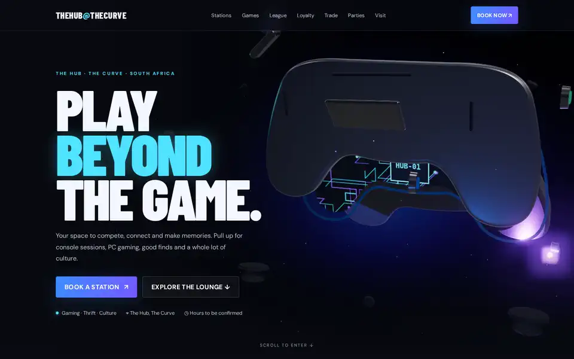

<p align="center">
  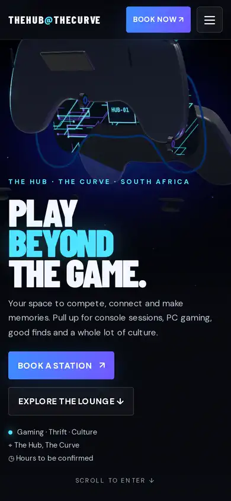
</p>

These loops cover the first eight seconds of the scroll story (exploded parts through to the assembled controller). Full page-scroll recordings (MP4) are linked below — GitHub’s README view does not play repository-hosted video files inline.

- [Desktop scroll recording](docs/videos/scroll_desktop_v2.mp4) (38 seconds)
- [Mobile scroll recording](docs/videos/scroll_mobile_v2.mp4) (45 seconds)

Or watch them on the Pages site: [desktop](https://gdotaim.github.io/thehub-curve-preview/docs/videos/scroll_desktop_v2.mp4) · [mobile](https://gdotaim.github.io/thehub-curve-preview/docs/videos/scroll_mobile_v2.mp4)

## Features

- **Scroll-driven 3D controller story.** A pinned, scrubbed sequence built with Three.js and GSAP ScrollTrigger. Exploded parts assemble, the RGB edge and buttons light up, and the story peaks on a PRESS START climax.
- **Section reactions.** After the climax the controller docks and responds to each section: stations, booking, games, league, loyalty, trade-in, and parties.
- **Procedural controller.** The gamepad is built from Three.js geometry in code. There are no external 3D models or textures to licence.
- **Mobile menu.** A compact navigation menu on small screens.
- **Reduced-motion fallback.** When `prefers-reduced-motion` is set, the controller stays assembled and powered on, with no scroll scrubbing.
- **No-JavaScript fallback.** Without JS (or if WebGL / the CDN fails), the page still shows the ordinary static layout.
- **Adaptive quality.** Pixel ratio is capped (lower on touch than on desktop). Rendering pauses when the tab is hidden. If frame rate stays low, the pixel ratio drops further and bloom can turn off.

## Screenshots

Captured from the v2 preview in software rendering. The full set lives in [`docs/screenshots/`](docs/screenshots/).

### Desktop

| Hero — exploded | Assembled | PRESS START |
| :---: | :---: | :---: |
| 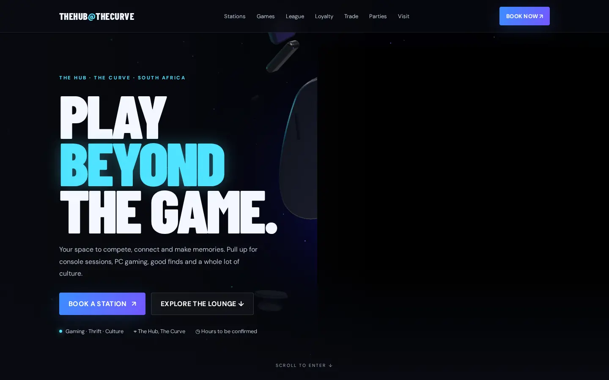 | 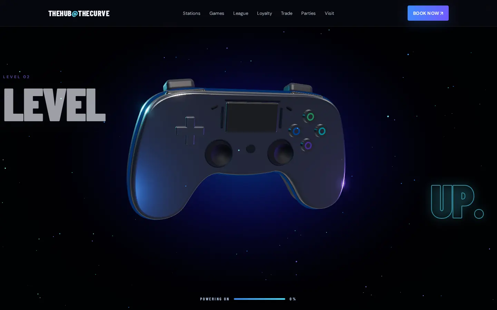 | 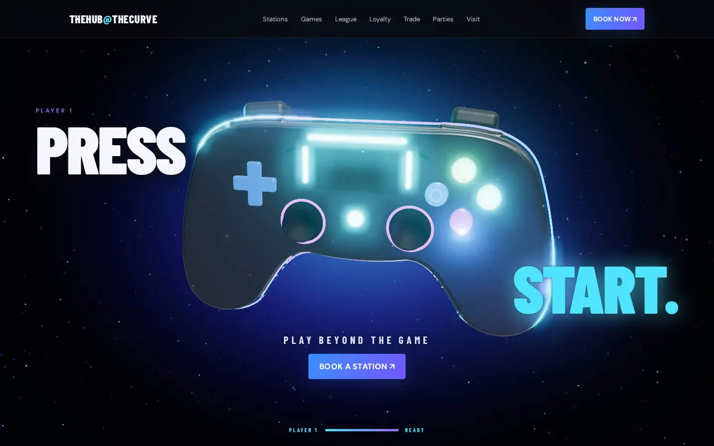 |

| Stations | Booking | Loyalty |
| :---: | :---: | :---: |
| 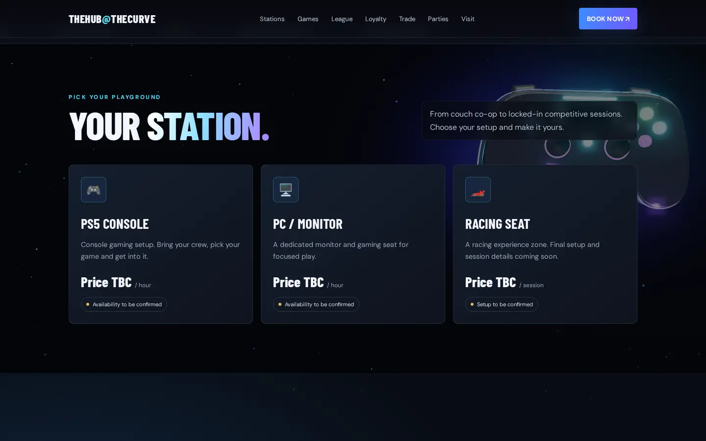 | 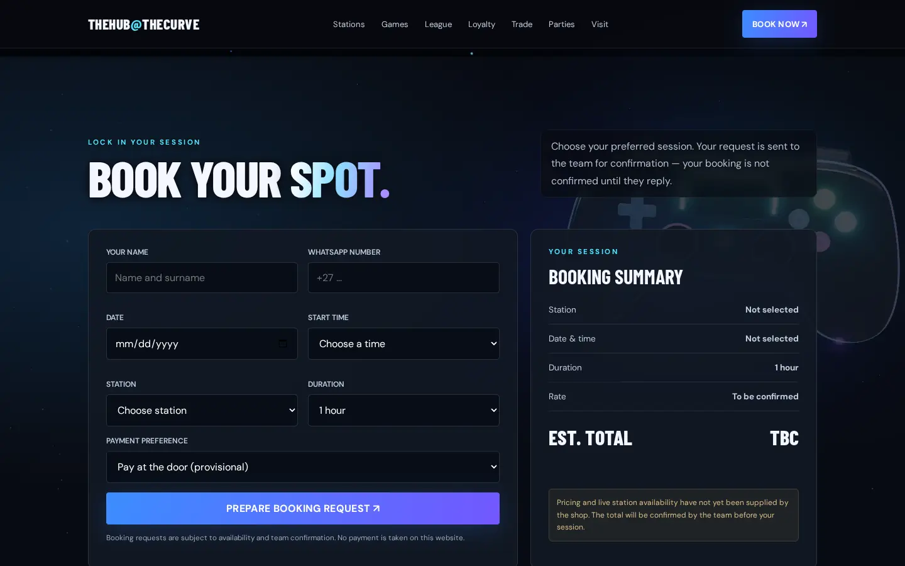 | 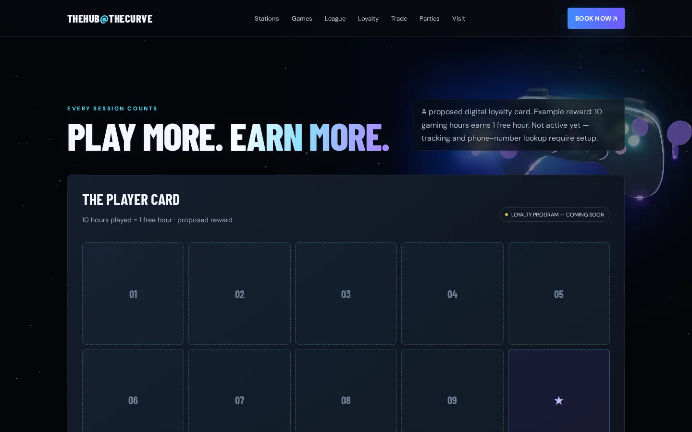 |

| Games | Trade-in | Visit |
| :---: | :---: | :---: |
| 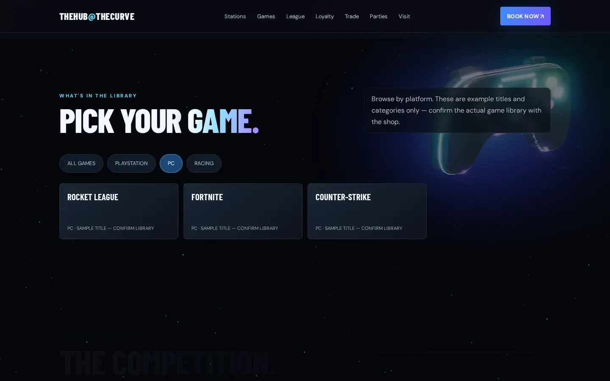 | 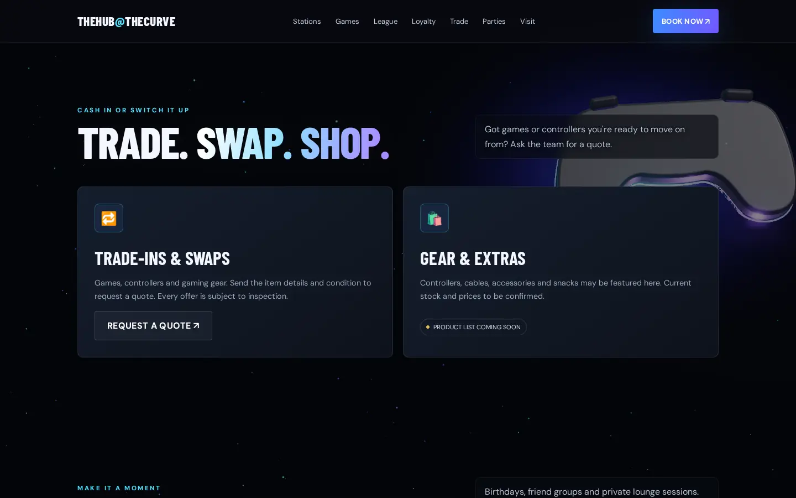 | 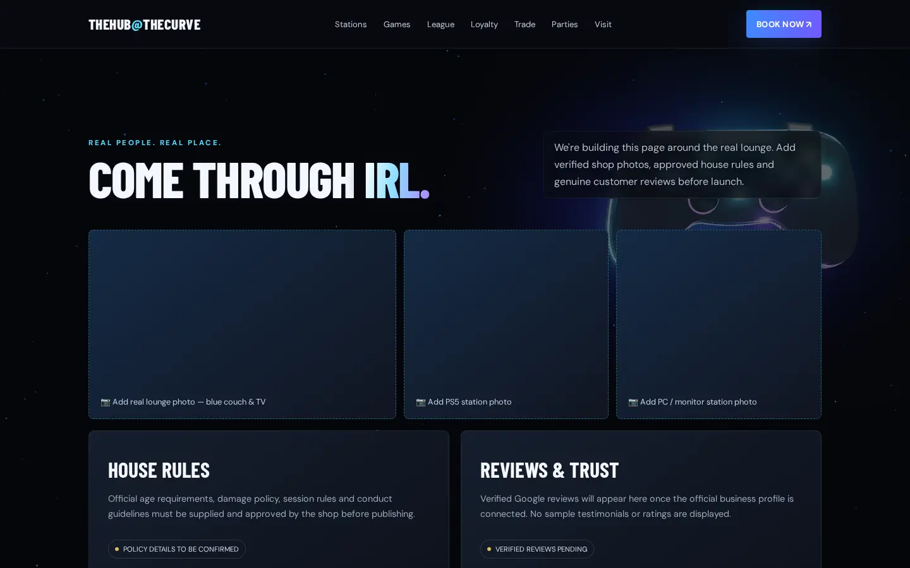 |

### Mobile

| Hero — exploded | PRESS START | Stations |
| :---: | :---: | :---: |
| 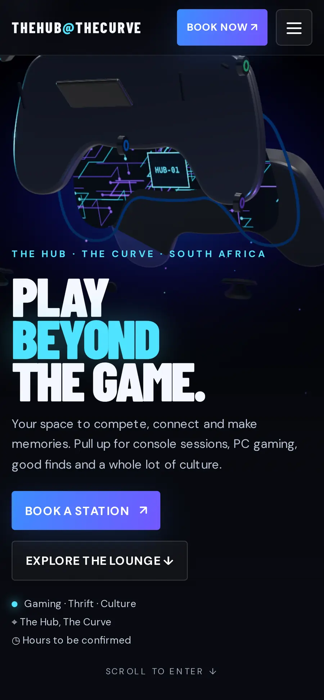 | 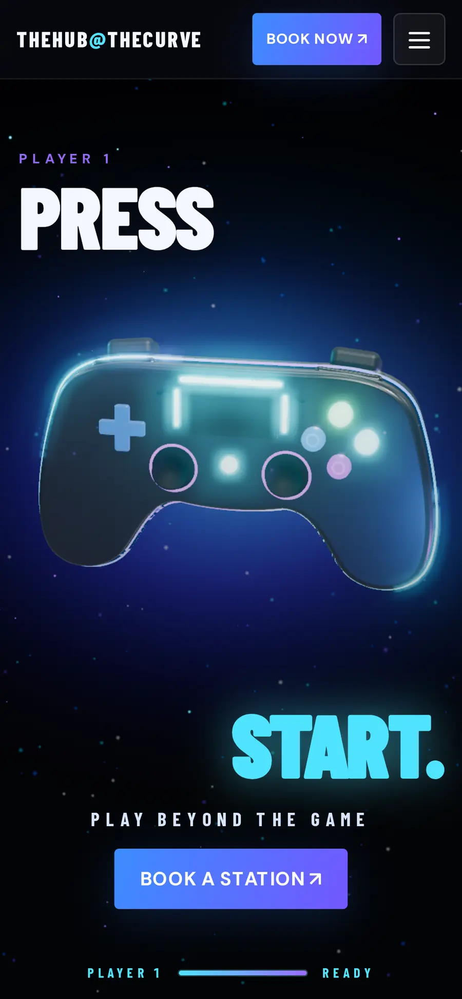 | 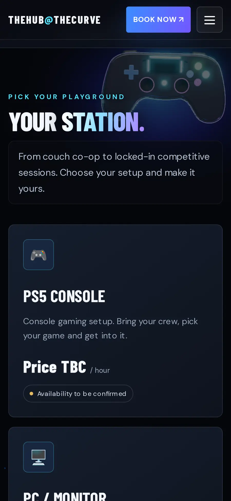 |

| Loyalty | Visit | Menu open |
| :---: | :---: | :---: |
| 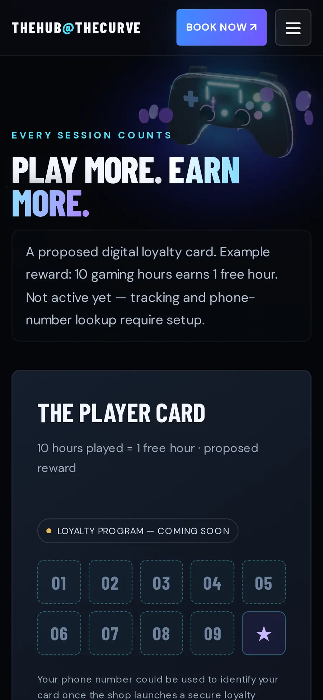 | 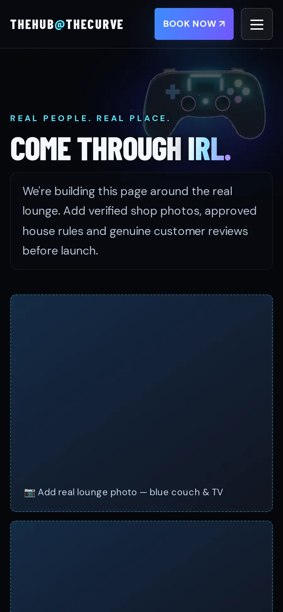 | 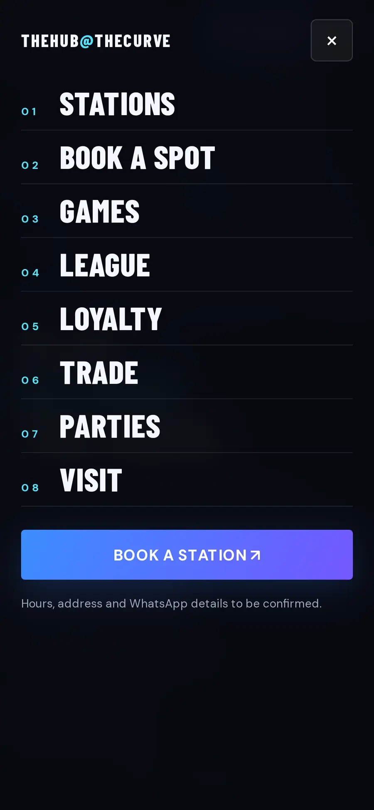 |

## Tech stack

| Piece | Version / source | Role |
| --- | --- | --- |
| HTML, CSS, and vanilla JavaScript | Single `index.html` | Page structure, styles, and behaviour |
| [Three.js](https://threejs.org/) | r170, jsDelivr | WebGL scene and procedural controller |
| Three.js examples add-ons | r170 `examples/jsm` | Rounded boxes, room environment, EffectComposer bloom |
| [GSAP](https://gsap.com/) + ScrollTrigger | 3.13.0, jsDelivr | Scroll-scrubbed timeline and section triggers |
| [Barlow Condensed](https://fonts.google.com/specimen/Barlow+Condensed) and [DM Sans](https://fonts.google.com/specimen/DM+Sans) | Google Fonts | Display and body type |

There is no build step, bundler, or backend. Booking requests on the preview are not confirmed until the shop replies, and the page does not process payments or store customer details.

## Project structure

```
.
├── index.html                 # Entire site (markup, styles, and 3D / scroll logic)
├── og-image.jpg               # Open Graph / Twitter share image (1200×630)
├── .nojekyll                  # Serve files as-is on GitHub Pages
├── README.md
├── LICENSE                    # MIT licence for the code
├── THIRD_PARTY_NOTICES.md     # Three.js, GSAP, and font licences
├── CHANGELOG.md
├── .gitignore
└── docs/
    ├── screenshots/
    │   ├── desktop/           # 17 compressed WebP stills
    │   └── mobile/            # 18 compressed WebP stills (includes menu open)
    └── videos/
        ├── hero-assembly-desktop.webp
        ├── hero-assembly-mobile.webp
        ├── scroll_desktop_v2.mp4
        └── scroll_mobile_v2.mp4
```

## Run locally

The site is static. From this directory, start any local web server so the ES modules and import map resolve correctly:

```bash
python3 -m http.server 8000
```

Then open [http://localhost:8000](http://localhost:8000). Three.js, GSAP, and the fonts load from CDNs, so an internet connection is needed for the 3D story and typography. The rest of the layout still works if those requests fail.

Opening `index.html` as a `file://` URL may be blocked by the browser’s module security rules. Prefer the local server.

## Deploy

This repository is already published with [GitHub Pages](https://gdotaim.github.io/thehub-curve-preview/) from the `main` branch root (the `index.html` at the top level is the site). To publish a similar static folder on another Pages repo:

1. Put `index.html`, `og-image.jpg`, and `.nojekyll` at the repository root.
2. In the repository settings, set Pages to deploy from the default branch, `/ (root)`.
3. After the site has a public URL, keep `og:image`, `twitter:image`, and `og:url` as absolute URLs pointing at that host.

`?capture` in the URL is only for automated screenshots and recordings. Do not share links that include it.

## Accessibility and performance

- **Reduced motion.** `prefers-reduced-motion: reduce` skips the scrubbed story and shows a static, assembled, powered-on controller.
- **No JavaScript / no WebGL.** The marketing layout, sections, and forms remain readable.
- **Adaptive rendering.** Pixel ratio is capped (1.75 on touch devices, 2 on desktop). Drawing pauses when the document is hidden. If the session stays under about 42 frames per second, the pixel ratio drops to 1.25 and bloom can be disabled.
- These are implementation details from the current code, not measured scores from a lab report or a real-device audit.

## Known limitations

- Recordings and screenshots were captured in software rendering, not on a real phone.
- On phones, the hero controller slightly overlaps the top of the hero text.
- On phones, there is a brief dark moment after the climax before the next section.
- Three.js, GSAP, and the fonts load from the jsDelivr and Google Fonts CDNs, so those features need a network connection.
- Section reactions on phones are small accents rather than the full desktop treatment.

## Placeholders

Before a real launch, replace the clearly marked placeholder content with approved business information, including:

- Station names, counts, prices, hours, and any live availability source
- The actual game library
- League or tournament dates, fees, prizes, and standings
- Loyalty terms
- Trade-in rules and stock
- Party packages and group capacity
- House rules and age policy
- Real photographs and reviews
- Street address and map pin, WhatsApp number, Instagram and TikTok handles
- Cross-promotion links (for example Soweto Thrift and the tattoo booth)

Sample games in the preview are not a claim about current inventory.

## Licence

The source code in this repository is licensed under the [MIT Licence](LICENSE). Copyright © 2026 Ntloso Ngubeni.

**The business name TheHub@TheCurve, its branding, and the site’s copy, images, and other content are not covered by the MIT licence.** All rights in those remain with their owners. The MIT grant applies to the code (markup, styles, and scripts), not to the brand or the content.

Third-party libraries and fonts are used under their own terms, documented in [THIRD_PARTY_NOTICES.md](THIRD_PARTY_NOTICES.md):

- Three.js r170 (and its examples add-ons) — MIT Licence
- GSAP 3.13 and ScrollTrigger — Standard “No Charge” GSAP License (not MIT)
- Barlow Condensed and DM Sans — SIL Open Font License 1.1
